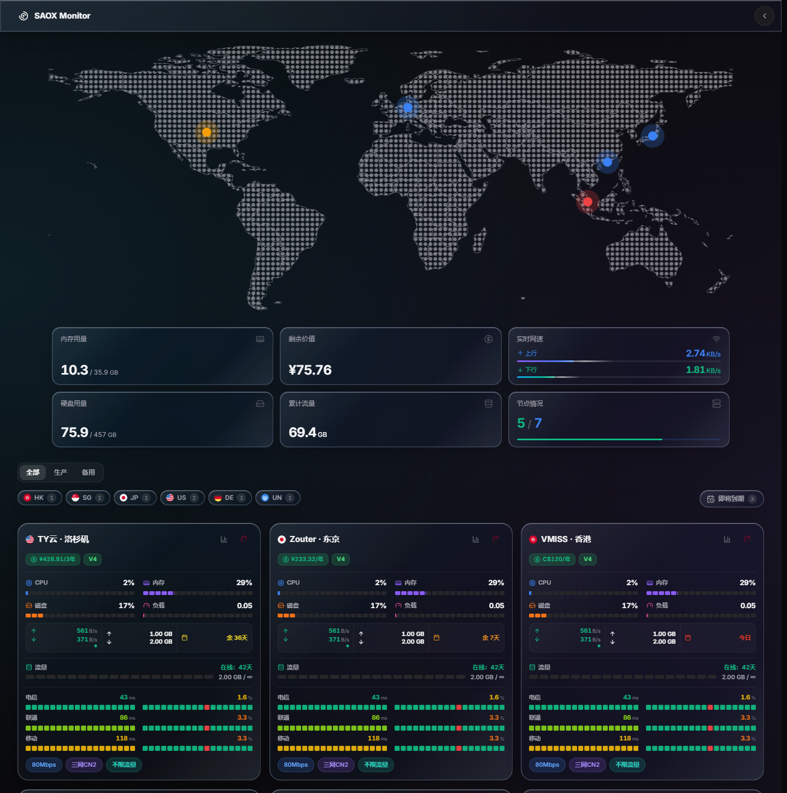
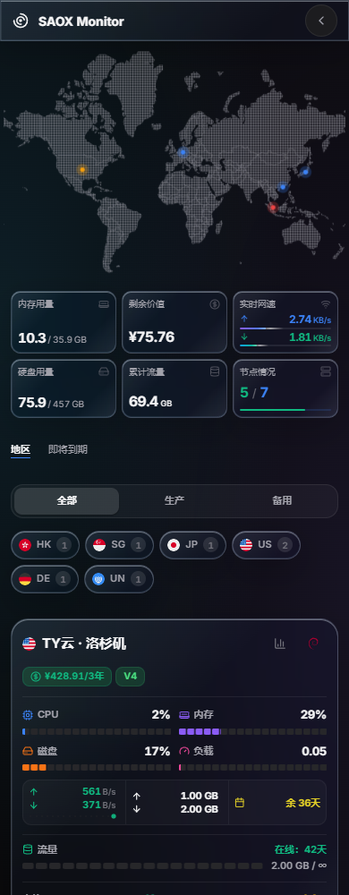
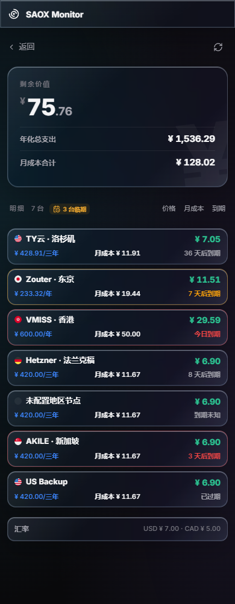

# SAOX

**SAOX 1.2.5** 是面向 [Monitor 极简探针](https://github.com/monitor-probe/monitor) 的独立主题，由 LuxJon 在 [WAOR/Monitor-SAO](https://github.com/WAOR/Monitor-SAO) 基础上定制。采用交互点阵世界地图、液态玻璃监控状态和三运营商延迟显示。

> 安装身份为 `saox`，可与原版 `sao` 同时保留在主题列表中。两个主题的服务端配置和浏览器偏好独立存储。Monitor 每次展示当前选中的一个主题。



## 使用范围

本仓库是 LuxJon 自用的二次定制版本。构建与发布只更新本仓库的 GitHub Release，不向 `monitor-probe/themes` 提交 PR，不修改公共主题列表，也不申请主题市场收录。保留 MIT 和上游来源说明不代表申请公共收录。

## 安装与升级

1. 从 [最新 Release](https://github.com/LuxJon/Monitor-SAOX/releases/latest) 下载 **theme.tar.gz**。
2. 在 Monitor 管理后台的「主题」页面上传安装包，选择并启用 **SAOX**。
3. 新装后确认站点外观及访客权限；原版 SAO 设置不会自动迁移。更新 SAOX 时保留 `short=saox` 即可沿用配置。

安装包必须直接包含 `theme.json`、`preview.png`、`LICENSE`、`THIRD_PARTY_NOTICES.md` 和 `dist/`，不应再套一层文件夹。**源码 ZIP 不能作为主题安装包导入。**

已对照 Monitor v1.5.0 的安装器检查目录结构、gzip 完整性、文件数量与大小；浏览器验收使用模拟 API，实际站点安装仍以后台结果为准。

## 当前功能

- 地图支持拖拽、惯性、双指缩放、双击及键盘操作，保留点阵效果与国家边界。点击地区可查看节点；选中点使用线性呼吸动画。
- 地图按服务器上报的国家或地区归集节点。展示国家级分布，不推测机房经纬度；没有地区的节点仍在节点列表中显示。
- 手机端将地图作为主要区域，下面是紧凑的六项状态，再向下滚动查看服务器。桌面端地图与状态完整展示，互不遮挡。
- 六项状态：内存用量、剩余价值、实时网速（上行/下行两行）、硬盘用量、累计流量、节点情况。
- 节点情况采用绿色在线数 / 蓝色总数；点击筛选离线节点，再次点击返回全部。
- 服务器与状态卡片采用液态玻璃样式；价格、IP 标签等高；底部备注以分号拆分为彩色标签。
- 默认展示电信、联通、移动三条真实 Ping 线路。支持自动识别与手动任务绑定；区分尚未加载、加载失败、无样本及未配置任务。
- 保留右上角快捷操作、深浅色切换、卡片密度、配色、流量明细和资产统计。管理员及访客可见性分别控制。



## 月成本与即将到期

- 资产页统一展示人民币：后台周期价格按汇率换算 CNY，再除以计费月数。三年 ¥428.91 ÷ 36 = ¥11.91/月，年付 ¥233.32 ÷ 12 = ¥19.44/月；不计入收购溢价。免费显示 ¥0.00，一次性费用没有月成本，汇率缺失不伪造价格。
- 手机监控卡左下方使用小号纯文字「地区 / 即将到期」切换；默认「地区」显示地区标签，切换「即将到期」后隐藏地区/分组标签并显示临期服务器，点「地区」恢复。桌面保留地区栏右侧的临期按钮。
- 临期范围仍按后台「到期提醒（天）」筛选。点击时清除地区、分组、离线筛选，按到期先后显示全部可见节点；桌面再次点击或「显示全部」恢复。
- 资产明细默认跟随首页配置的节点顺序（包含离线置后）。手机仅保留「价格 / 月成本 / 到期」三个纯文字排序项，重复点同一项切换升降序；返回页面恢复首页默认顺序。卡片上行是名称/剩余价值，下行是左侧价格、居中月成本、右侧到期，长名称和大金额自动适配窄屏。
- 提醒天数直接来自管理员接口 `/api/settings` 的 `notify_expiry`，不是主题另设的固定天数。0 表示关闭；包含今日到期，不包含已过期；优先使用后端 `expires_in`，与后台日期口径一致。后台变更后，回到前台、重新点击按钮或一分钟刷新时更新。
- Monitor 当前不向访客公开提醒天数，因此未登录时提示登录后台；读取失败显示重试，不猜测 7 天。不读取或保存任何通知凭据。



## 两处主题设置

Monitor 后台提供 25 项基础设置；登录后的前台「SAOX 主题设置」提供完整高级编辑，修改会自动保存到当前站点的 `/api/themes/saox/config`。保存失败会显示错误，不会显示成已同步。

| 分组 | 后台基础设置 | 前台高级设置 |
| --- | --- | --- |
| 首页总览 | 默认外观、地图与状态、跟随分组 | 同左；六项状态及离线筛选说明 |
| 节点卡片 | 桌面/手机卡片、分组地区、指标、默认排序 | 分组次序、流量光柱与配色预览 |
| 三网延迟 | 自动三网模式 | 线路选择、节点任务绑定、延迟/丢包阈值与色阶 |
| 资产统计 | 汇率接口 | 不计入统计的节点、买入溢价 |
| 访问权限 | 登录入口、管理员昵称、流量/价格公开、资产入口 | 同左及隐藏节点名单 |

默认卡片为 compact，手机不提供列表模式。首页已移除访客排序菜单，仅由管理员设置默认顺序。后台与前台共享服务端配置；浏览器临时外观与视图偏好使用 `saox:*` 存储，不读取旧 SAO 的键。

## 开发与打包

需要 Node.js 22+ 和 npm。所有命令从本仓库根目录执行：

```sh
npm ci
npm run dev
npm run lint
npm run typecheck
npm test
npm run package
```

打包会生成：

- `theme.tar.gz`：Monitor 可导入的主题包，也是自动更新识别的固定资产名。
- `SAOX-1.2.5-source.zip`：当前源码，不含依赖、缓存或历史聊天产物。
- `SHA256SUMS`：两个包的 SHA-256 校验值。

`theme.json` 和 `package.json` 版本必须一致。推送 `v1.2.5` 标签会在 GitHub Actions 执行 lint、类型检查、测试、构建及打包，成功后发布 Release。不要手工修改构建输出替代源码变更。

## 仓库结构

- `src/`：React/TypeScript 页面、组件、业务与监控数据适配。
- `public/`：运行时资源、空的 SAOX 静态配置兜底及第三方许可证。
- `scripts/`：安装包、源码包与校验值生成。
- `docs/`：当前版本桌面、手机和设置预览。
- `.github/workflows/`：构建与发布。
- `theme.json`：主题身份、版本与后台基础设置声明。

这是 **Monitor 主题**；原仓库的 Komari/Vue 配置、ZIP 安装约定与旧版 Glassmorphism 说明不再适用于本版本。

## 开源许可与来源

MIT。保留 WAOR 的原始版权声明，LuxJon 维护 SAOX 修改。地图数据及视觉参考的作者、来源和许可见 [THIRD_PARTY_NOTICES.md](THIRD_PARTY_NOTICES.md) 与 [public/licenses](public/licenses)。本项目不代表上游作者或参考主题的官方发行。
